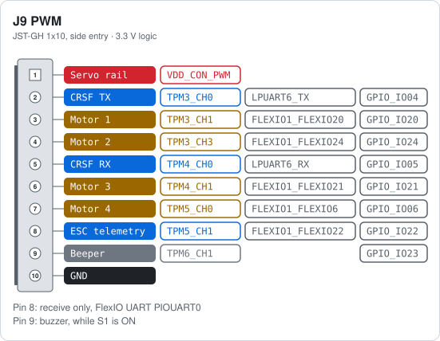
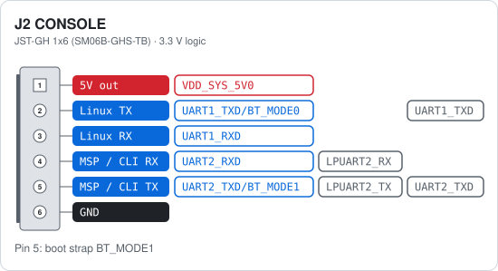

# Betaflight on the MR-NAVQ95

Betaflight runs on the Cortex-M7 of the i.MX95, while Linux keeps running on the Cortex-A55
cores. The two talk over rpmsg: Linux gets the Betaflight MSP and CLI port as `/dev/ttyBF`, and
Betaflight writes its blackbox logs as files on the Linux side.

> [!WARNING]
> Betaflight on the NavQ95 is preliminary beta support and may still change. It is not in a
> Betaflight release yet: the code is in
> [betaflight/betaflight#15853](https://github.com/betaflight/betaflight/pull/15853) and the board
> configuration in [betaflight/config#1231](https://github.com/betaflight/config/pull/1231).
> Feel free to test it, and report what you find in the pull request.

## 1. Linux BSP

Use the Linux BSP linked in the [README](README.md#software-stack):
https://github.com/NXP-Robotics/imx-manifest-navq95. Build and flash it as described there.

The BSP has the System Manager that gives the M7 its peripherals, and the Linux side of the rpmsg
link (`/dev/ttyBF` and the blackbox file server).

> [!IMPORTANT]
> An older System Manager does not give all peripherals to the M7. Betaflight still boots but skips
> those peripherals, for example no receiver on LPUART6. If a port or output does nothing, update
> the BSP first.

## 2. Build and flash Betaflight

### Get the code

```sh
git clone https://github.com/betaflight/betaflight
cd betaflight
git fetch origin pull/15853/head:navq95
git checkout navq95
git submodule update --init src/config
```

The MR_NAVQ95 board configuration is not in the config repository's master branch yet, so point
`src/config` at the config pull request:

```sh
git -C src/config fetch https://github.com/betaflight/config pull/1231/head
git -C src/config checkout FETCH_HEAD
```

### Build

```sh
make arm_sdk_install imgtool_install    # once: compiler and imgtool
make MR_NAVQ95
```

mcuboot only boots a signed image, so the build signs it with imgtool. The other submodules the
i.MX95 needs (device headers, OpenAMP, libmetal) are fetched by the build. The image to flash is
`obj/betaflight_<version>_MIMX9596_MR_NAVQ95.bin`. Do not flash the `.bin.raw` file next to it:
that one is not signed.

### Flash

The image runs in place from the octal NOR flash, in mcuboot slot 0 at `0x28020000`. Flash it
over the debug header ([Main J7](README.md#main-j7-debug)) with the pyocd fork from the BSP, as
in the BSP's
[Flash NOR flash image](https://github.com/NXP-Robotics/imx-manifest-navq95#flash-nor-flash-image)
section: remove the SD card, power the board, then run

```sh
pyocd flash -t mimx95_cm33_mx25um --base-address 0x28020000 obj/betaflight_<version>_MIMX9596_MR_NAVQ95.bin -f 10m
```

NOR writes are not fully stable yet. Run the command again until pyocd reports that it programmed
0 pages.

### Start

Put the SD card back and power the board. mcuboot starts Betaflight on the M7 from the NOR flash;
Linux boots from the SD card and attaches to the running M7 through remoteproc. Linux does not
load or start the M7 image itself. When the link is up, `/dev/ttyBF` exists on the NavQ95.

A reboot from Betaflight (the CLI `reboot` command, or Save and Reboot in the App) restarts only
the M7, through the System Manager. Linux keeps running.

## 3. Connect the Betaflight App

Betaflight has MSP and the CLI on LPUART2 at 115200 baud.

1. Connect the USB-C console port [IO J1](#io-j1-console) to the PC. Its CP2105 gives two serial
   ports: the first is the Linux console, the second is Betaflight (usually `/dev/ttyUSB1` on
   Linux, the second COM port on Windows).
2. Open the Betaflight App (https://master.app.betaflight.com, see the note below[^app]), pick
   that port and click Connect.

To connect over the network instead, see the [appendix](#appendix-connect-over-the-network).

## 4. Pinout

The cards show the pins as the MR_NAVQ95 board configuration sets them up. For the other
connectors, see the [hardware reference](README.md#connector-index).

| Function | Peripheral | Connector |
|---|---|---|
| Motors 1 to 4 (DShot on FlexIO1, PWM on TPM3 to TPM5) | FlexIO1, TPM3, TPM4, TPM5 | [IO J9](#io-j9-pwm) pins 3, 4, 6, 7 |
| Receiver, CRSF | LPUART6 | [IO J9](#io-j9-pwm) pins 2 (TX), 5 (RX) |
| ESC telemetry, receive only | FlexIO1 UART (PIOUART0) | [IO J9](#io-j9-pwm) pin 8 |
| Beeper | GPIO | [IO J9](#io-j9-pwm) pin 9, buzzer on the IO board |
| MSP and CLI | LPUART2 | [IO J1](#io-j1-console) CP2105 port 2, [Main J2](#main-j2-console) pins 4, 5 |
| GPS | LPUART5, LPI2C6 | [IO J8 GPS](README.md#io-j8-gps) |
| Telemetry UART | LPUART7 | [IO J6 TELEM](README.md#io-j6-telem) |
| CAN, DroneCAN | FlexCAN2, FlexCAN3 | [IO J4 CAN2](README.md#io-j4-can2), [IO J3 CAN3](README.md#io-j3-can3) |
| Battery voltage | ADC channel 0 (VIN) | [Main J9 PWR_IN](README.md#main-j9-pwr_in) |

<!-- heading:io/J9 -->
### IO J9 PWM
<!-- /heading -->

<!-- pinout:io/J9 -->
<picture>
  <source media="(prefers-color-scheme: dark)" srcset="images/betaflight/io-J9-dark.svg">
  
</picture>

DShot runs on FlexIO1; the TPM channel gives PWM when a PWM protocol is selected. The ESC telemetry input is a receive only FlexIO UART (PIOUART0) for KISS ESC telemetry; the telemetry wire of the ESC goes to pin 8. The receiver uses CRSF on LPUART6: receiver TX to pin 5, receiver RX to pin 2. Pin 1 is the servo rail and is not linked to the board 5 V (R60 not fitted), so the receiver needs 5 V from another connector, for example the 5 V pin of the GPS or TELEM connector.

> [!NOTE]
> The beeper is the buzzer on the IO board and the buzzer pin of the GPS connector. Both work only while DIP switch S1 is ON.
<!-- /pinout -->

<!-- heading:main/J2 -->
### Main J2 CONSOLE
<!-- /heading -->

<!-- pinout:main/J2 -->
<picture>
  <source media="(prefers-color-scheme: dark)" srcset="images/betaflight/main-J2-dark.svg">
  
</picture>

LPUART2 carries MSP and the CLI at 115200 baud. The same UART is port 2 of the CP2105 on the USB-C console port J1 of the IO board, so a USB-C cable is all a PC needs. Use either J1 or this header, not both at the same time.

> [!NOTE]
> UART1 TX and UART2 TX are boot straps. Keep them idle while the board resets, or it may boot from the wrong source.
<!-- /pinout -->

<!-- heading:io/J1 -->
### IO J1 CONSOLE
<!-- /heading -->

<!-- notes:io/J1 -->
The CP2105 gives two serial ports on one USB-C connection. Port 1 (ECI) is the Linux console, port 2 (SCI) is LPUART2, where Betaflight has MSP and the CLI. On a Linux PC port 2 is usually ttyUSB1 (`/dev/serial/by-id/...-if01-port0`); on Windows it is the second of the two COM ports.
<!-- /notes -->

## 5. Blackbox logging

Betaflight sends its blackbox logs over rpmsg to Linux, which stores them as files.

1. In the CLI:

   ```text
   set blackbox_device = VIRTUAL
   save
   ```

2. On the NavQ95, [rpmsgfs-server](https://github.com/NXP-Robotics/rpmsgfs-server) (a service
   in the BSP that runs as `user`) writes the logs to `/betaflight` as `LOGnnnnn.BFL`. Create
   that directory once:

   ```sh
   sudo mkdir -p /betaflight
   sudo chown user:user /betaflight
   ```

Open the logs in [Blackbox Explorer](https://blackbox.betaflight.com/). The OSD shows the
blackbox as `OK`, without a fill percentage.

> [!TIP]
> With `blackbox_mode = ALWAYS` Betaflight logs all the time, about 200 MB per hour. Use
> `set blackbox_mode = NORMAL` to log only while armed and save space.

## 6. First flight checklist

The general setup is the same as on any Betaflight flight controller; see the
[Betaflight setup guide](https://betaflight.com/docs/wiki/getting-started/setup-guide). On the
MR-NAVQ95, check at least these:

1. **Accelerometer.** Put the board level and calibrate the accelerometer in the
   [Setup tab](https://betaflight.com/docs/wiki/app/setup-tab). ANGLE mode needs it.
2. **Receiver.** The receiver port (LPUART6, CRSF) is already set. Check that the sticks move the
   right channels in the [Receiver tab](https://betaflight.com/docs/wiki/app/receiver-tab).
3. **Modes.** Put ARM and ANGLE on switches; see
   [Modes](https://betaflight.com/docs/wiki/guides/current/Modes).
4. **Motors.** With the props off, check the motor order and the direction of each motor in the
   [Motors tab](https://betaflight.com/docs/wiki/app/motors-tab), and fix them before the first
   flight. For KISS ESC telemetry on J9 pin 8, turn on the ESC Sensor feature.
5. **Blackbox.** Set it up as in [Blackbox logging](#5-blackbox-logging).

The configuration is saved in the NOR flash, with a backup copy, so it is kept when the SD card
or the Linux image changes.

## Appendix: connect over the network

The NavQ95 can share `/dev/ttyBF` on TCP port 5761 with socat:

```text
Betaflight App --> (websockify on the PC) --> TCP 5761 --> socat on the NavQ95 --> /dev/ttyBF --> M7
```

On the NavQ95, start the bridge (as `user`; no root needed):

```sh
nohup socat TCP-LISTEN:5761,reuseaddr,nodelay,keepalive,fork,max-children=1 \
    /dev/ttyBF,rawer,echo=0 >/tmp/bf-bridge.log 2>&1 &
```

Stop it with `pkill -f TCP-LISTEN:5761`. The bridge does not start again after a reboot.

> [!WARNING]
> Only one program can use `/dev/ttyBF` at a time. The port has no password and can spin the
> motors, so use it on a trusted network only.

**app.betaflight.com in a browser.** The web app can only connect to `ws://localhost`, so run
websockify on the PC (Linux, macOS or WSL):

```sh
python3 -m venv ~/wsv && ~/wsv/bin/pip install websockify    # once
~/wsv/bin/websockify 5761 <navq95-ip>:5761
```

Then in the App:

1. Options: turn on Expert mode, then "Enable manual connection mode".
2. In the port list choose Manual Selection, enter `ws://localhost:5761` and click Connect.
3. If the browser asks for local network access, allow it.

**Betaflight desktop app.** The desktop app opens TCP itself, so websockify is not needed. Install
it from https://github.com/betaflight/betaflight-configurator/releases, turn on the same two
options and connect to `tcp://<navq95-ip>:5761`.

[^app]: Betaflight 2026.12 (MSP API 1.49) moves serial port setup out of the Ports tab: each
    feature now picks its own UART in its own tab (Receiver, GPS, OSD and so on), and the Ports
    tab only shows the result. The released App (2026.6, at https://app.betaflight.com and on the
    releases page) predates this and is not fully compatible with this firmware. Use the App's
    master snapshot at https://master.app.betaflight.com, which follows these changes.
